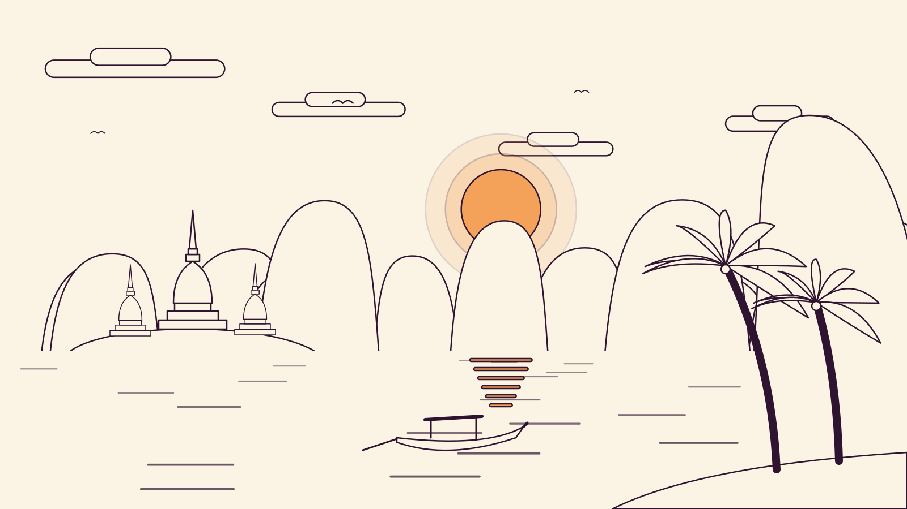
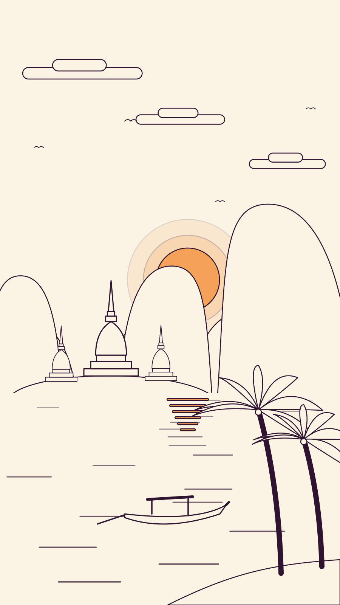

# tokengaroo

A [Claude Code](https://claude.com/claude-code) skill that turns a plain-language prompt into an
animated, geometric SVG background for a travel site, then checks it for visual artifacts before
you see it.

> "do Australia" → Uluru, red dunes, a ghost gum and a kangaroo that kicks up dust when it lands.

<p>
  
  
</p>
<p>
  
  
</p>

- **Code, not pixels.** Every background comes from a small script, so it is crisp at any size,
  15–25 KB, editable, and the same seed always gives the same picture.
- **Two formats:** desktop 16:9 and mobile 9:16. Mobile is its own layout, not a crop.
- **Styles:** flat colour and ink line-art. A new style works for every region at once.
- **Pure CSS motion.** It plays inside `` and CSS `background-image`, with no JavaScript, and
  has a still layout for `prefers-reduced-motion`.
- **Zero dependencies:** Node ≥ 22 and a local Chrome.

## Install

```sh
git clone https://github.com/recferret-bit/tokengaroo.git
ln -s "$PWD/tokengaroo" ~/.claude/skills/tokengaroo
```

Then in Claude Code: `/tokengaroo do Canada, autumn, line style`, or just ask for a region background.

## Use without Claude

```sh
node template/generate.mjs --all --out dist           # every region × style × format + dist/index.html
node template/generate.mjs --region thailand --style flat --format mobile > thailand.svg
node scripts/check.mjs --out qa                       # visual QA, report in qa/report.md
```

On a website:

```css
.hero { background: url(/bg/thailand-flat-desktop.svg) center / cover; }
@media (orientation: portrait) { .hero { background-image: url(/bg/thailand-flat-mobile.svg); } }
```

## The QA harness

`scripts/check.mjs` drives headless Chrome over the DevTools protocol and runs three checks on every
variant. It writes `report.md` with fix hints, evidence screenshots with the problem boxed, and a
mid-animation frame of each variant. The skill makes Claude read these, fix the cause and rerun.

| Check | Catches |
|---|---|
| **grounding** | sky showing below the horizon (reads as a lake); a landmark with sky under its base (floats) |
| **landmark** | foreground covering the hero landmark (names the layer and %); landmark cropped on tall phones or ultrawide screens |
| **motion** | loops that jump or flash when they restart; with reduced motion: elements cut by the edge, copies piled on one spot, effects frozen visible |

Every check exists because the artifact really happened while building the first two regions.

## Layout

```
SKILL.md                    instructions Claude follows: workflow, contract, design rules
scripts/check.mjs           QA harness
template/                   the generator; copied into a project on first use
  generate.mjs              orchestration: render(), variants(), CLI
  lib/                      canvas + seeded RNG, formats, styles, CSS registry, preview page
  objects/<kind>/<name>.mjs one object per file: sky, animals, plants, terrain, water, landmarks, buildings, vehicles
  regions/<name>.mjs        one region per file: palettes, landmark, scene()
examples/                   output of template/generate.mjs --all
```

Adding a region is one file in `regions/` plus any new objects it needs; see `SKILL.md` for the
object and region templates.
