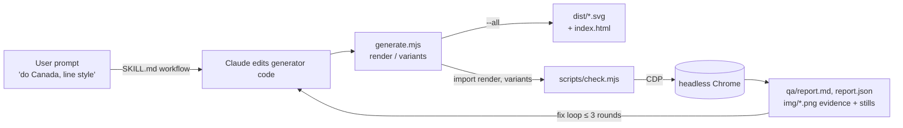
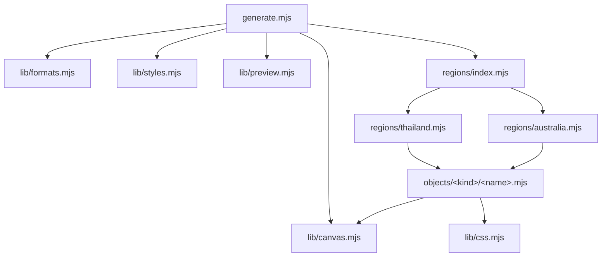

# Architecture

How a prompt becomes an SVG, and the invariants that keep it deterministic and checkable.

## Big picture



The generator is code, not a model: Claude translates intent into JS objects and scenes. The harness
imports the generator module directly (not its CLI output), so it always checks exactly what `render()` produces.

## Module graph



Dependencies only point downward: regions → objects → lib. Objects never import regions; lib never
imports objects. `generate.mjs` is the only module with side effects (the CLI, and only when executed directly).

## The render pipeline

`render(regionName, styleName, formatName, seed = 7)` in `template/generate.mjs`:

1. **Resolve** `REGIONS[regionName]`, `FORMATS[formatName]`, `region.palettes[styleName]` and
   `STYLES[styleName]`. Unknown names throw with the list of valid ones.
2. **`begin(fmt, seed)`** sets the live canvas bindings `W`, `H`, `HORIZON` and reseeds the RNG.
3. **Build `ctx`:**

   | Field | Type | Meaning |
   |---|---|---|
   | `ctx.p` | object | The region's palette for this style |
   | `ctx.s` | painter | `STYLES[style](p)`: `paint()`, `line()`, `sky`, `water` |
   | `ctx.m` | boolean | `true` on mobile; branch layout on it |
   | `ctx.k` | number | Motif scale for the format (1 desktop, 1.2 mobile) |
   | `ctx.css` | `Map<key, css>` | CSS registry filled by `useCss()` while objects draw |

4. **`region.scene(ctx)`** returns an ordered object `{ layerName: svgString }`. Key order is draw order,
   back to front. Each entry is wrapped as `<g data-layer="layerName">…</g>`.
5. **Assemble** the root `<svg>`: `<defs>` (sky + water gradients), `<style>` (every registered CSS block
   once, then the reduced-motion kill switch), the sky `<rect data-layer="sky">`, then the layers.

`variants()` enumerates `region × style-that-region-has-a-palette-for × format`, named
`<region>-<style>-<format>`. Both `--all` and the harness use it, so a region with no `line` palette has no line variants.

## Output anatomy

```xml
<svg xmlns="http://www.w3.org/2000/svg" viewBox="0 0 1600 900" preserveAspectRatio="xMidYMid slice"
     role="img" aria-label="thailand background" data-horizon="620" data-landmark="temple">
<defs>
  <linearGradient id="sky">…skyTop → skyBottom (or paper)…</linearGradient>
  <linearGradient id="water">…waterTop → waterBottom (falls back to skyBottom, paper)…</linearGradient>
</defs>
<style>
  /* one block per useCss() key, in first-use order */
  @media (prefers-reduced-motion: reduce) { * { animation: none !important } }   ← always last
</style>
<rect data-layer="sky" width="1600" height="900" fill="url(#sky)"/>
<g data-layer="clouds">…</g>
<g data-layer="sun">…</g>
…
</svg>
```

- `preserveAspectRatio="xMidYMid slice"` makes the SVG behave like `background-size: cover`. The harness's
  `cropped` check models exactly this against a range of screen shapes.
- Numbers are rounded to one decimal by `f()` to keep files small.

## Canvas and formats

`lib/formats.mjs`:

| Format | `w × h` | `horizon` | `k` | Notes |
|---|---|---|---|---|
| `desktop` | 1600 × 900 | 620 | 1 | 16:9; must survive 16:10 … 21:9 crops |
| `mobile` | 900 × 1600 | 1040 | 1.2 | 9:16; must survive 9:20 … 9:16 crops; more sky for headlines |

Objects import `W`, `H`, `HORIZON` from `lib/canvas.mjs`. These are ES module **live bindings**
(`export let`), so they reflect the current `begin()` call. They are `0` until `render()` runs. Read
them inside functions only.

## Styles

`lib/styles.mjs` maps a style name to a factory `(palette) => painter`:

| Style | `paint(c, {accent})` | `line(c, w)` | `sky` / `water` |
|---|---|---|---|
| `flat` | `fill=c` | stroke `c`, width `w` (default 3), round caps | `url(#sky)` / `url(#water)` gradients |
| `line` | fill `paper` (or `c` if `accent`), stroke `ink` 2.5 | stroke `ink`, width `w` (default 2.5); **ignores `c`** | `paper` / `paper` |

Because objects only colour through the painter, adding a style is one entry here plus a palette with
that key in every region. Every region × format gets the new style automatically.

## CSS registry

`useCss(ctx, key, css)` stores `css` under `key` the first time it is called during a render. So:

- a picture only carries keyframes for objects it actually draws;
- an object drawn N times emits its CSS once;
- objects that share a motion share a key through a helper (`plants/sway.mjs` → key `sway`, class `.crown`).

CSS can interpolate canvas values (`translateX(${W + 120}px)`) because it is built during the render.

## Determinism

- One `mulberry32(seed)` stream per render. `random()` returns `[0, 1)`; `between(a, b)` returns `a + r·(b − a)`.
- Same seed + same code ⇒ byte-identical SVG. The committed `examples/` are seed 7, and a fresh build
  reproduces them exactly.
- **Order matters, not just count.** The stream is consumed in JS *evaluation* order, which is not the
  same as layer order. In `australia.scene()`, the three `groundBand()` calls run *before* the returned
  object literal is evaluated, so they consume randomness before `clouds()`. Inside the literal,
  properties evaluate top to bottom.
- Consequences:
  - Inserting a random call reshuffles every later random value in that picture. Prefer deterministic
    values (rest poses are deterministic for this reason), or append new random calls **after** existing ones and tell the user the layout changed.
  - A refactor must preserve call order to stay byte-identical.
  - Per-object RNG cost is listed in [`api-reference.md`](api-reference.md).

## Motion model

- Pure CSS `@keyframes` on SVG elements. No JS, no SMIL, so it plays in `` and `background-image`.
- **Travelling elements** (clouds, birds, kangaroo) get a `transform` *attribute* as their rest pose. The
  running CSS animation's `transform` overrides it. Under reduced motion the animation is off and the attribute shows.
- **Transient effects** (kangaroo dust) set `opacity: 0` in their own reduced-motion block.
- **Pivots:** crowns use `style="transform-origin: Xpx Ypx"` in viewBox units. Spin/scale effects use
  `transform-box: fill-box; transform-origin: center`.
- **Coupled motion** (hop and dust) shares one period (0.75 s) and start. The dust drift is derived from
  the kangaroo's run speed: `(W + 400) / 24 s × 0.75 s / k`.
- Global kill switch: `@media (prefers-reduced-motion: reduce) { * { animation: none !important } }`, always last.

## The harness contract

What `scripts/check.mjs` relies on. Break any of these and it reports `contract` findings:

| Contract | Where it is produced |
|---|---|
| `generate.mjs` exports `render(region, style, format, seed)` and `variants()` | `generate.mjs` |
| CLI runs only when the file is executed directly (`import.meta.url === argv[1]`) | `generate.mjs` last line |
| Root `<svg>` has `viewBox`, `data-horizon`, `data-landmark` | `render()` |
| Every layer is a direct child `<g data-layer="name">` | `render()` wrapping `scene()` |
| Sky is `<rect data-layer="sky">` | `render()` |
| `region.landmark` names an existing layer that paints something | region file |
| Reduced-motion rule is the last rule in `<style>` | `render()` |

## Size and performance

- Output is 15–24 KB per variant today (Thailand flat desktop is the smallest, Australia line desktop the largest).
- Biggest contributors: `water()` (22 wave lines), `ghostGum()` (15 ellipses), `spinifexField()` (one path per tuft).
- Rendering is instant. A full harness run over 8 variants takes about 2 s on a laptop.
