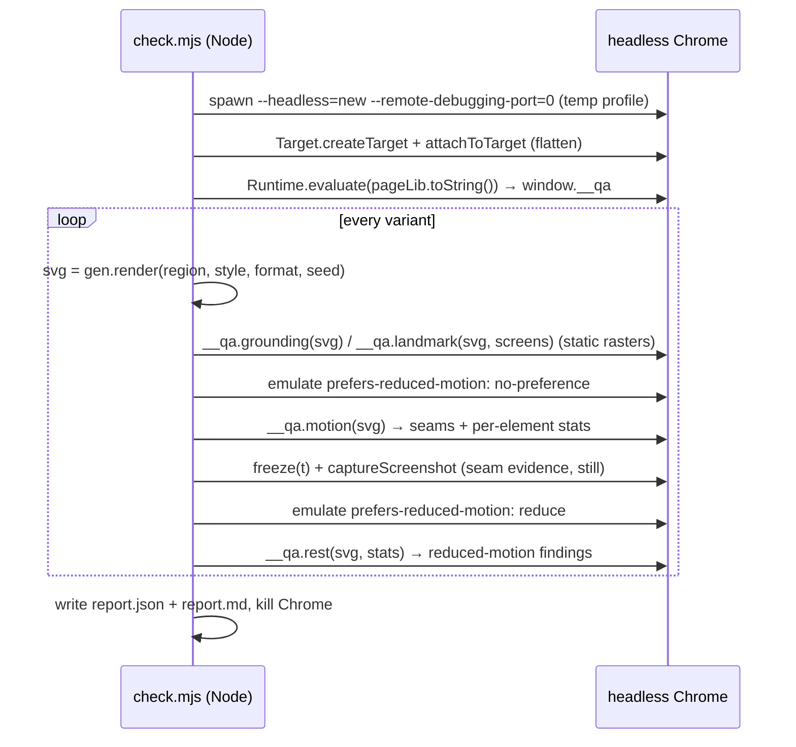

# QA harness: `scripts/check.mjs`

A single-file, zero-dependency harness. It imports the generator, renders every variant, loads it into
headless Chrome over the DevTools protocol (CDP), and runs three visual-artifact checks. Each check
exists because the artifact really happened while the first two regions were built.

## CLI

```sh
node scripts/check.mjs [--gen <generate.mjs>] [--out <dir>] [--only <substr>] [--seed <n>] [--still <ms>]
```

| Flag | Default | Meaning |
|---|---|---|
| `--gen` | `../template/generate.mjs` (relative to `check.mjs`) | Generator module; must export `render()` and `variants()` |
| `--out` | `./qa` (relative to cwd) | Output dir. **Deleted recursively first.** |
| `--only` | all | Keep variants whose name contains the substring (`australia`, `mobile`, `thailand-line`) |
| `--seed` | `7` | Seed passed to `render()` |
| `--still` | `10000` | Timeline position (ms) of the still frame saved per variant |
| `CHROME_PATH` env | auto | Chrome binary. Auto-discovery covers the usual macOS and Linux paths only |

Exit codes: `0` everything passes · `1` findings · `2` harness error (no Chrome, bad `--gen`, no variant matches, crash).

## Outputs

```
<out>/report.md                 human/agent summary: table + per-finding fix hints + evidence links. Start here.
<out>/report.json               machine-readable, see schema below
<out>/svg/<variant>.svg         exactly what was checked
<out>/img/<variant>.still.png   real frame at --still ms (normal motion)
<out>/img/<variant>.grounding.png         evidence, only if grounding failed
<out>/img/<variant>.landmark.png          evidence, only if landmark failed
<out>/img/<variant>.motion-seam-<n>.png   up to 3 seam frames, element boxed
<out>/img/<variant>.motion-rest.png       reduced-motion still with offending elements boxed
```

### `report.json` schema

```jsonc
{
  "generator": "/abs/path/generate.mjs", "seed": 7,
  "limits": { /* LIMITS */ }, "screens": { /* SCREENS */ },
  "results": [{
    "region": "australia", "style": "flat", "format": "mobile", "name": "australia-flat-mobile",
    "still": "img/australia-flat-mobile.still.png",
    "checks": {
      "grounding": { "status": "pass|fail", "findings": [{ "kind", "message", "hint" }], "metrics": { "skyLeakPx", "floatingShare" }, "evidence": [] },
      "landmark":  { "status", "findings", "metrics": { "visible", "covered", "cropped", "safe", "culprits": [{ "layer", "share" }] }, "evidence": [] },
      "motion":    { "status", "findings", "metrics": { "animations" }, "evidence": [] }
    }
  }]
}
```

`landmark.metrics.culprits` is filled even on a pass. It is the best early warning for a foreground layer
creeping over the landmark.

## How it runs



`pageLib` is serialised with `toString()` and evaluated in the page, so it **must not reference anything
from the Node module scope**. `LIMITS` is passed in as its argument.

## The checks

### 1. grounding (static raster, animations off)

The SVG is rasterised to a canvas with the sky rect repainted **magenta** (`#ff00ff`) and the landmark
layer painted **cyan** (`#00ffff`).

| Kind | Rule |
|---|---|
| `sky-leak` | Any magenta pixel from `horizon + skyLeakRows` (2) down to the bottom |
| `floating` | For each column containing landmark pixels, find the lowest one. If the pixel 3 rows below it is sky, the column floats. Fails if more than `floatColumns` (2 %) of landmark columns float |
| `contract` | No `data-horizon`, or the landmark layer paints nothing |

### 2. landmark visibility

Three rasters: the landmark **alone**, the full **composite** (landmark cyan), and the composite with each
later layer hidden in turn.

- **Safe area** = the region every target screen shape shows under `xMidYMid slice`:
  `wf = min(1, screens.min / ratio)`, `hf = min(1, ratio / screens.max)`, centred.

  | Format | Screen range (w/h) | Safe box on the canvas |
  |---|---|---|
  | desktop 1600×900 | 16:10 … 21:9 | x 80–1520, y 107–793 |
  | mobile 900×1600 | 9:20 … 9:16 | x 90–810, y 0–1600 |

- `covered = 1 − composite / alone`, `cropped = 1 − alone∩safe / alone`, `visible = composite∩safe / alone`.
- Fails if `visible < landmarkVisible` (85 %). It reports `covered` (if > 2 %) with culprits sorted by share,
  and/or `cropped` (if > 2 %).
- **Culprits**: a later layer whose removal reveals more than 1 % of the landmark.

### 3. motion

**3a. Seams** (normal motion). Every CSS animation in the mounted SVG is paused and scrubbed with `currentTime`.
- 24 samples per period record mean opacity and horizontal travel (`travel` = centre range / W).
- At each loop boundary `t` from the first iteration up to `max(windowMs, 2·dur)`, it compares `t − 1 ms`
  and `t + 1 ms`. If the element is on canvas at either side and moves more than `popPx` (4 px) or
  changes opacity by more than `popOpacity` (0.3), that is a `seam`.
- `alternate` animations are skipped (they cannot seam).

**3b. Rest** (`prefers-reduced-motion: reduce` emulated).

| Kind | Rule |
|---|---|
| `reduced-runs` | Any animation still running |
| `rest-cut` | A **traveller** (`travel > 0.5`) at rest is between 10 % and 90 % inside the canvas (cut by the edge) |
| `rest-pileup` | More than one traveller of the same animation rests at the same `x0` (±3 px) |
| `frozen-transient` | Mean animated opacity below 0.35 but rest opacity above 0.6 (a puff or flash frozen visible) |

Findings on descendants of an already-reported element are suppressed.

## Limits

```js
const LIMITS = {
  skyLeakRows: 2, floatColumns: 0.02, landmarkVisible: 0.85,
  popPx: 4, popOpacity: 0.3, transientMeanOpacity: 0.35,
  edgeCut: 0.1, travel: 0.5, windowMs: 60000,
};
```

**Never loosen these to get a pass.** If a finding is a genuine false positive, change the check's
*logic* for that whole class of element and say so in your summary.

## Evidence colour key

| Image | Means |
|---|---|
| `*.grounding.png` | sky magenta, landmark cyan, red box = problem area |
| `*.landmark.png` | landmark cyan, red boxes = what covers it, dashed black box = safe area |
| `*.motion-seam-N.png` | real frame 1 ms after the jump, red box = the element |
| `*.motion-rest.png` | reduced-motion still, red boxes = offending elements |

## Known limitations

- **Colour collisions.** Pixel classification uses ±40 per channel around magenta and cyan (alpha > 200).
  A palette colour close to `#ff00ff` (hot pink, cherry blossom) in a ground layer can be counted as a
  sky leak. One close to `#00ffff` (tropical water, glacier ice) inside the safe area can inflate the
  landmark's visible share. Check new palettes against both.
- **Hero landmark only.** Secondary motifs (the kangaroo, the boat) are not checked for being covered or cropped.
- **One seed.** Only `--seed` (default 7) is checked. Other seeds can produce layouts that fail.
- **Meaning is out of scope.** The checks can't tell whether a shape reads as what it is meant to be.
  Always look at the stills.
- **Hang risk.** CDP calls have no timeout, and a WebSocket close does not reject pending calls. If Chrome
  dies mid-run the harness can hang instead of exiting `2`.
- **Platforms.** Chrome auto-discovery covers macOS and Linux paths only. On Windows, set `CHROME_PATH`.

## Extending a check

1. Add the logic inside `pageLib` (page-side, self-contained) and return `{ findings: [{ kind, message, box? }], metrics }`.
2. Add a `HINTS[kind]` entry. It is the fix advice printed in `report.md` and is what Claude acts on.
3. If it needs evidence, capture it in `checkVariant()` and describe its colours in `EVIDENCE`.
4. Add a threshold to `LIMITS` instead of inlining a magic number.
5. Document it in `SKILL.md` § The three checks, `README.md` § The QA harness, and this file.
6. Prove it: make a variant that should fail, see the finding and evidence, then revert and confirm all pass.
